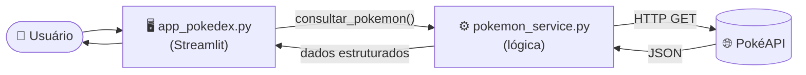
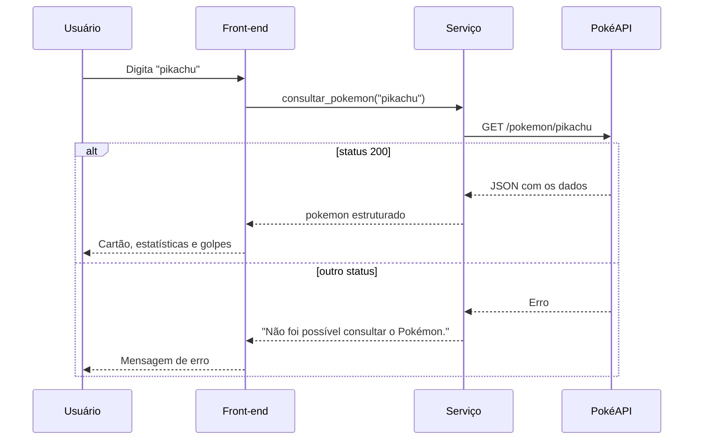

<div align="center">


# 🔴 Revisão Pokémon API

**Consumo de APIs REST com Python: do script em console à interface interativa.**


[📌 Sobre](#-sobre) •
[🗂️ Estrutura](#️-estrutura) •
[🧩 Arquitetura](#-arquitetura) •
[🚀 Como executar](#-como-executar) •
[🎮 Funcionalidades](#-funcionalidades) •
[📚 Conceitos](#-conceitos-revisados)

</div>

---

## 📌 Sobre

Repositório de **revisão para prova de API**. O projeto consome a [PokéAPI](https://pokeapi.co/) para praticar os fundamentos de integração com serviços REST:

- requisições HTTP com `requests`;
- tratamento de *status codes* e de falhas de conexão;
- leitura e tratamento de respostas em JSON;
- separação entre **lógica** e **interface**;
- criação de uma API própria com **Flask**.

> 💡 **Ponto de partida:** o código original tinha menos de 15 linhas e apenas imprimia o nome do Pokémon. A partir dele, o projeto evoluiu para uma Pokédex interativa.

```python
resposta = requests.get(f"https://pokeapi.co/api/v2/pokemon/{nome}")

if resposta.status_code == 200:
    dados = resposta.json()
    print(f"Pokémon: {dados['name']}")
else:
    print("Não foi possível consultar o Pokémon.")
```

---

## 🗂️ Estrutura

```text
revisao-pokemon-api/
├── 📁 pokemon-api/          # Consulta à PokéAPI e interface em Streamlit
├── 📁 pokemon-api-flask/    # API própria desenvolvida com Flask
└── 📄 README.md
```

<details>
<summary><b>📁 Arquivos do módulo Streamlit (clique para expandir)</b></summary>

<br>

| Arquivo | Responsabilidade |
|---|---|
| `streamlit_pokemon.py` | **Front-end.** Contém apenas a interface, dividida em funções por componente. |

</details>

<!-- AJUSTAR: confirmar se os arquivos acima estão na pasta pokemon-api ou em outra -->

---

## 🧩 Arquitetura

A interface e a lógica ficam em arquivos distintos. O front-end nunca faz requisições diretamente: ele sempre chama o módulo de serviço.



**Fluxo de uma consulta**



---

## 🚀 Como executar

### 1. Clonar o repositório

```bash
git clone https://github.com/luizasilva08/revisao-pokemon-api.git
cd revisao-pokemon-api
```

### 2. Criar o ambiente virtual *(recomendado)*

<details>
<summary><b>🪟 Windows</b></summary>

```bash
python -m venv venv
venv\Scripts\activate
```

</details>

<details>
<summary><b>🐧 Linux / 🍎 macOS</b></summary>

```bash
python3 -m venv venv
source venv/bin/activate
```

</details>

### 3. Escolher o módulo

<details open>
<summary><b>🖥️ Interface em Streamlit</b></summary>

```bash
pip install streamlit requests pandas
cd pokemon-api
streamlit run app_pokedex.py
```

O aplicativo abrirá em `http://localhost:8501`.

**Execução apenas em console** (comportamento do script original):

```bash
python pokemon_service.py
```

</details>

<details>
<summary><b>🧪 API em Flask</b></summary>

```bash
pip install flask requests
cd pokemon-api-flask
python app.py
```

O servidor ficará disponível em `http://localhost:5000`.

</details>

<!-- AJUSTAR: confirmar o nome do arquivo principal do Flask (app.py) e a porta -->

---

## 🎮 Funcionalidades

<div align="center">

| 🔎 Busca | 🎲 Descoberta | 📊 Dados | 🎨 Visual |
|:---:|:---:|:---:|:---:|
| Pesquisa por nome | Pokémon aleatório | Estatísticas base | Cores por tipo |
| Entrada normalizada | Atalhos populares | Habilidades | Versão *shiny* |
| Tratamento de erros | Filtro de golpes | Altura, peso e exp. | Grito em áudio |

</div>

**Destaques técnicos**

- ✅ Cache das consultas (`st.cache_data`) para evitar requisições repetidas
- ✅ *Timeout* nas requisições e captura de falhas de conexão
- ✅ Retorno padronizado no formato `(dados, erro)`
- ✅ Lógica reutilizável em console, Streamlit ou Flask

---

## 📚 Conceitos revisados

<details>
<summary><b>🌐 O que é uma API REST?</b></summary>

<br>

Interface que permite a comunicação entre sistemas por meio de requisições HTTP. Cada recurso possui uma URL, e a resposta normalmente é entregue em JSON.

</details>

<details>
<summary><b>🔢 Principais status codes</b></summary>

<br>

| Código | Significado | Uso neste projeto |
|:---:|---|---|
| `200` | OK | Consulta realizada com sucesso |
| `404` | Não encontrado | Nome de Pokémon inexistente |
| `500` | Erro interno | Falha no servidor da API |

</details>

<details>
<summary><b>🧱 Por que separar lógica e interface?</b></summary>

<br>

- **Reutilização:** a mesma lógica atende console, Streamlit e Flask.
- **Manutenção:** alterações visuais não afetam a consulta aos dados.
- **Testes:** a lógica pode ser testada sem iniciar a interface.

</details>

<details>
<summary><b>📦 Estrutura dos dados retornados</b></summary>

<br>

```python
{
    "id": 25,
    "nome": "pikachu",
    "tipos": ["electric"],
    "altura_m": 0.4,
    "peso_kg": 6.0,
    "stats": [{"chave": "hp", "valor": 35}, ...],
    "habilidades": [{"nome": "static", "oculta": False}, ...],
    "golpes": ["Thunder", "Thunderbolt", ...],
}
```

</details>

---

## 🔗 Referências

- 📘 [Documentação da PokéAPI](https://pokeapi.co/docs/v2)
- 📗 [Documentação do Streamlit](https://docs.streamlit.io/)
- 📙 [Documentação do Flask](https://flask.palletsprojects.com/)
- 📕 [Biblioteca Requests](https://requests.readthedocs.io/)

---

<div align="center">

Desenvolvido por **[Luíza da Silva](https://github.com/luizasilva08)** 💻

*Dados fornecidos pela [PokéAPI](https://pokeapi.co/). Pokémon é marca registrada de Nintendo, Game Freak e The Pokémon Company.*

⭐ Se este repositório foi útil, considere deixar uma estrela.

</div>
